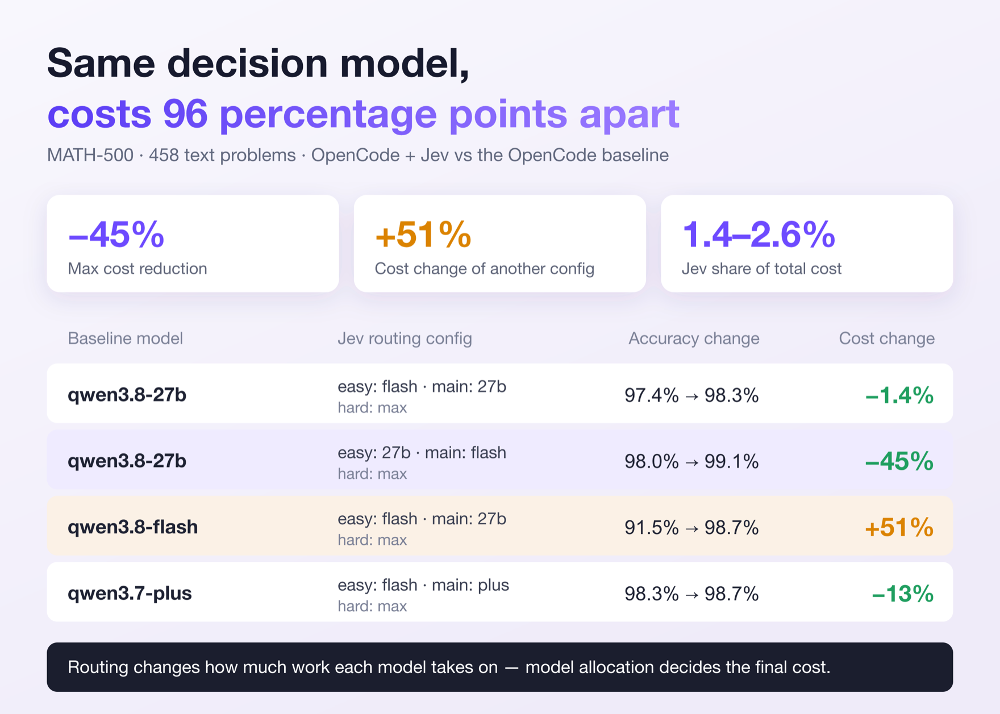
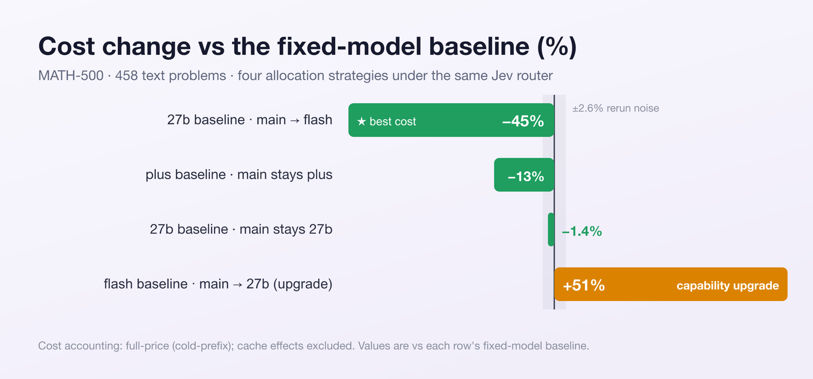

<div align="center">

# Pi JEV Governor

A decision governance layer for the [pi](https://pi.dev) coding agent, powered by JEV.

**Planning · Model Routing · Permission Control · Outcome Validation**

Pi JEV Governor brings fast, typed, confidence-aware decisions into the pi agent lifecycle — deciding how a task should start, which model should handle it, whether tool actions may proceed, and whether the task is actually ready to finish.

**Up to 45% lower model cost on MATH-500, with no accuracy loss.**<br>
Jev decision overhead **1.4–2.6%** of cost · decision latency **P50 0.6–0.7 s**

[](https://github.com/Pyromind-Dynamics/pi-jev-governor/actions/workflows/ci.yml)
[](LICENSE)


*Deterministic rules handle hard boundaries. JEV handles bounded decisions. Humans handle low-confidence and high-risk cases.*

**English** | **[简体中文](README.zh-CN.md)**

</div>

<p align="center">
  
</p>

## 🚦 Project Status

- ✅ Plan strategy routing: `direct` / `plan_only` / `plan_then_execute`
- ✅ Model-tier routing: `small` / `normal` / `strong`
- ✅ Model compatibility guards
- ✅ Layered permission governance
- ✅ Outcome validation and automatic correction
- ✅ Structured decision logging
- ✅ MATH-500 routing benchmark of the JEV routing mechanism
- ✅ Pi 0.87.1 and 1.1.0 acceptance-tested (54 assertions each)
- 🚧 npm release
- 🚧 Broader coding-task benchmarks
- 🚧 Additional routing policies

## 📊 Benchmark Results

The MATH-500 benchmark evaluates the JEV-based three-tier routing design used by Pi JEV Governor: tasks are routed to easy, main, or hard and compared against a fixed-model baseline. The evaluation uses 458 text-only problems from HuggingFaceH4/MATH-500 (42 image-based problems excluded). The benchmark focuses on model routing; the plugin's planning, permission, and outcome-governance features are outside this benchmark's scope.

Across the four configurations, accuracy was maintained or improved, while cost ranged from **−45% to +51%** depending on how execution models were assigned to the routing tiers. The router itself is cheap; the dominant factor is which model it sends the work to.

<p align="center">
  
</p>

| Baseline Config | Jev Routing Config | Accuracy Change | Cost Change |
|---|---|---|---|
| qwen3.8-27b | easy: flash / main: 27b / hard: max | 97.4% → 98.3% | −1.4% |
| qwen3.8-27b | easy: 27b / main: flash / hard: max | 98.0% → 99.1% | **−45%** |
| qwen3.8-flash | easy: flash / main: 27b / hard: max | 91.5% → 98.7% | +51% |
| qwen3.7-plus | easy: flash / main: plus / hard: max | 98.3% → 98.7% | −13% |

**Key findings**

- Up to 45% lower cost with no accuracy loss.
- Routing policy matters: placing the cheap model in the dominant main tier creates much larger savings than using it only for easy.
- Price spread matters: larger cost differences between tier models create larger potential savings.
- The +51% configuration is intentional: it upgrades the dominant main tier to a stronger model, trading budget for capability.
- JEV overhead is small: 1.4–2.6% of total cost, with 0.6–0.7 s P50 decision latency.

> The third configuration's larger accuracy gain (+7.2 pp) mainly reflects its much weaker starting baseline.
>
> Cost is reported at full price; cache discounts are excluded.
>
> 📊 Full report and methodology: [docs/math500-final-report-20261003.md](docs/math500-final-report-20261003.md)

## 🧠 How It Works

Pi JEV Governor places JEV at four bounded decision points in the agent lifecycle, while deterministic rules and human fallback remain responsible for hard safety boundaries.

<p align="center">
  
</p>

### Four decision points

| Decision | When | Output |
|---|---|---|
| Planning | task start | `direct` / `plan_only` / `plan_then_execute` |
| Model tier | task start | `small` / `normal` / `strong` |
| Permission | each tool call | rule → JEV → human / fail-closed |
| Outcome | before settle | `finish` / `retry` / `replan` |

- `plan_strategy` and `tier` share a single request. A `plan_then_execute` task makes an additional Outcome request to validate the plan before execution.
- Planning revisions and execution corrections share a hard maximum of **2** automatic corrections.
- Loaded directly by pi. **No bundled runtime dependencies. Does not modify pi itself.**

<details>
<summary><strong>Detailed lifecycle semantics &amp; state</strong></summary>

```text
user prompt
   │
   ▼
route: plan_strategy + tier
   ├─ direct ────────────────────────────────┐
   ├─ plan_only (read-only) ─────────────────┤
   └─ planning (read-only)                   │
        │ Outcome validates the plan         │
        ├─ retry/replan → revise plan        │
        ├─ finish → restore tools, execute   │
        └─ unavailable/low confidence → stop │
                                              ▼
                                     Outcome validates delivery
                                        ├─ finish → settle
                                        └─ retry/replan → correct and continue
```

- Each new `before_agent_start` begins a task and clears its approval cache. Continuations, steering, and follow-ups inherit the active route.
- State is stored as `jev-state` session entries. Resume and tree navigation restore from the active branch via `getBranch()`, including the read-only tool snapshot, correction budget, and model-routing state.
- Continuation is committed atomically at the settle boundary: state entry + `custom_message` with `continue: true`, then pi recomputes whether the final context can continue.

</details>

## 🎬 See It in Pi

Four tasks recorded in the pi TUI — not slides: after each prompt is submitted, the bottom status bar (`jev:<phase>/<tier>`) and the model indicator in the bottom-right corner re-route live.

<table>
<tr>
<td align="center" width="50%"><br><b>One-line knowledge question → <code>direct/small</code></b><br><i>the model drops qwen3.7-plus → qwen3.7-flash</i></td>
<td align="center" width="50%"><br><b>Routine three-step implementation → <code>direct/normal</code></b><br><i>back up qwen3.7-flash → qwen3.7-plus</i></td>
</tr>
<tr>
<td align="center" width="50%"><br><b>Risky multi-consumer refactor → <code>plan_then_execute/strong</code></b><br><i>read-only planning on qwen3.7-max before any edit</i></td>
<td align="center" width="50%"><br><b>Architecture design question → <code>plan_only/strong</code></b><br><i>analysis only — stays on qwen3.7-max, no implementation</i></td>
</tr>
</table>

Recorded with `scripts/run.sh --models qwen/qwen3.7-plus,qwen/qwen3.7-flash,qwen/qwen3.7-max`.

## 🚀 Quick Start

**1. Install** (requires pi 0.87.1+):

```bash
pi install git:github.com/Pyromind-Dynamics/pi-jev-governor
```

**2. Configure** — the JEV credential and one model per tier:

```bash
export PI_JEV_API_KEY="$OPENROUTER_API_KEY"
export PI_JEV_MODEL_SMALL="openrouter:qwen/qwen3.7-flash"
export PI_JEV_MODEL_NORMAL="openrouter:qwen/qwen3.7-plus"
export PI_JEV_MODEL_STRONG="openrouter:qwen/qwen3.7-max"
```

**3. Run `pi`**, submit a task, and watch `jev:<phase>/<tier>` in the status bar.

Try without installing: `pi -e ./pi-jev-governor`. The repo also ships a `.env.local` template and launcher (`./scripts/run.sh`) — see the Configuration section below.

> Both pi 0.87.1 and 1.1.0 pass the full acceptance suite (54 assertions each; evidence in [`evidence/acceptance-20261008-163809`](evidence/acceptance-20261008-163809) for 0.87.1 and [`evidence/acceptance-20261008-180941`](evidence/acceptance-20261008-180941)). `@earendil-works/pi-ai` and `@earendil-works/pi-coding-agent` are peer dependencies supplied by pi. Pinned installs (`@<tag>`) and npm publishing become available with the first release.

## ⚙️ Configuration

```bash
cp .env.local.example .env.local   # fill in your keys and models
./scripts/run.sh                   # run from any scratch project directory
```

The variables that matter most:

| Variable | Default | Notes |
|---|---|---|
| `PI_JEV_API_KEY` | *required* | API credential |
| `PI_JEV_MODEL_SMALL` / `_NORMAL` / `_STRONG` | *required* | `provider:modelId` for each tier |
| `PI_JEV_ROUTE_CONFIDENCE` | `0.8` | Below → direct/current-model fallback |
| `PI_JEV_PERMISSION_CONFIDENCE` | `0.9` | Below → human approval or fail-closed |
| `PI_JEV_OUTCOME_CONFIDENCE` | `0.8` | Plan only advances on high-confidence finish |
| `PI_JEV_MAX_CORRECTIONS` | `2` | Task-wide budget, hard-capped at 2 |

<details>
<summary><strong>Full configuration reference</strong></summary>

| Variable | Default | Notes |
|---|---|---|
| `PI_JEV_ENABLED` | `true` | Set `false` to disable all four decisions |
| `PI_JEV_URL` | `https://openrouter.ai/api/alpha/decisions` | JEV endpoint |
| `PI_JEV_API_KEY` | *required* | API credential |
| `PI_JEV_MODEL` | `typesafe/jev-1.13` | Decision model |
| `PI_JEV_TIMEOUT_MS` | `3000` | Total deadline per request (1–60000 ms). OpenRouter typically answers in 2–4 s; `10000` is practical |
| `PI_JEV_MODEL_SMALL` | *required* | `provider:modelId` |
| `PI_JEV_MODEL_NORMAL` | *required* | `provider:modelId` |
| `PI_JEV_MODEL_STRONG` | *required* | `provider:modelId` |
| `PI_JEV_ROUTE_CONFIDENCE` | `0.8` | Below → direct/current-model fallback |
| `PI_JEV_PERMISSION_CONFIDENCE` | `0.9` | Below → human approval or fail-closed |
| `PI_JEV_OUTCOME_CONFIDENCE` | `0.8` | Plan only advances on high-confidence finish |
| `PI_JEV_MAX_CORRECTIONS` | `2` | Task-wide budget, hard-capped at 2 |
| `PI_JEV_OUTCOME_GIT_DIFF` | `false` | Opt in to `git diff --stat`; full diff is never sent |
| `PI_JEV_PLAN_AUTO_EXECUTE` | `true` | `false` → plans require UI confirmation |
| `PI_JEV_LOG_DIR` | platform state dir | Explicit log directory override |

</details>

Model references use `provider:modelId` format (split on the first colon).

> **Tip:** tier switching only happens within the routed model's scope.
>
> - The scope comes from `--models` (plural) or from enabledModels in pi settings; list all three tiers for free switching.
> - With only a subset, switches to out-of-scope tiers are skipped by the `scopedModels` guard: a one-time TUI warning appears, the status bar keeps showing the routed tier, and the model indicator stays unchanged.
> - To pin a single model, pass it as the only `--models` entry.
> - `--model` (singular) only picks the initial model — it creates no scope and does not block switching.

**Tier switching** keeps the current model when the target cannot be resolved, is outside `--models` scope, has insufficient context window, cannot accept images already in the branch, lacks provider auth, or the user manually changed models.

### Switches & status

- `pi --no-jev` — disable plugin for this invocation
- `/jev` — show current phase, tier, correction budget, decision count, and log file
- `/jev off` / `/jev on` — session-level toggle (`on` cannot override `--no-jev` or `PI_JEV_ENABLED=false`)

## 🛡 Safety & Privacy

### Permission gate

Four-layer permission pipeline:

1. **Phase gate** — planning phases allow only built-in read tools and allowlisted read-only shell commands
2. **Deterministic rules** — block hard-deny shell patterns, allow built-in read tools, honor task approvals
3. **JEV adjudication** — clean, sanitized tool input sent to JEV
4. **Human / fail-closed** — `ask`, low confidence, sensitive input, or remote error → user prompt; no UI → block

Human choices are task-scoped: allow once · allow exact call for task · allow tool for task · block. Caches clear on next task and on session-tree navigation.

### Privacy

The plugin sends the **minimum evidence** needed for each decision:

| Data | Remote behavior |
|---|---|
| Task prompt | Truncated, secret literals scrubbed |
| Ordinary tool input | Sensitive keys redacted, length limited |
| Clean shell command | Sanitized then sent |
| Command with credentials | **Never sent** — local confirmation or fail-closed |
| Sensitive-file evidence | Replaced with omission marker |
| Tool-result tail | ≤ 10 entries, truncated and redacted |
| `git diff --stat` | Only when explicitly enabled; full diff never sent |

Credential detection is intentionally narrow (Authorization/Bearer headers, `KEY=value` credential contexts, private-key headers, configured secrets). Broad entropy matching is not used — hashes and git SHAs are common in legitimate commands.

<details>
<summary><strong>Decision logs</strong></summary>

Each session gets its own `decisions-<session-id>.jsonl` file. Log directory priority:

1. `PI_JEV_LOG_DIR`
2. `$XDG_STATE_HOME/pi-jev`
3. macOS: `~/Library/Application Support/pi-jev`
4. Windows: `%LOCALAPPDATA%/pi-jev`
5. Fallback: `~/.local/state/pi-jev`

Directories: mode `0700`; files: mode `0600`. Logs contain structured answers, confidence, timing, usage, effective action, and sanitized error reasons — never raw prompts, tool arguments, provider bodies, or keys.

</details>

### Failure behavior

Missing or invalid remote configuration enters `degraded` mode (not a full bypass): routing falls back to direct/current-model, outcome automation stops, but the local permission gate stays active. Calls that need remote judgment ask the user when a UI is available and fail closed when it is not.

### Security boundary

This package is **workflow control, not an OS sandbox**. It runs inside pi with the same process privileges. Use containerization or another system security boundary for untrusted or unattended execution.

## 🧪 Development & Testing

```bash
npm install
npm run typecheck
npm test
```

Tests cover decision logic, extension wiring, parallel permission confirmations, branch recovery, log permissions, and a real public-API agent lifecycle using pi's faux provider.

### Acceptance testing

An automated acceptance harness exercises the plugin end-to-end: real pi, real agent models, and a deterministic local JEV mock. Each case leaves per-case evidence and a summary `RESULTS.md`:

```bash
./scripts/run-acceptance.sh    # 23 cases (H01–H22 plus the H20b variant); requires .env.local and pi on PATH
```

Interactive TUI behavior is covered by the manual screenshot protocol in [docs/acceptance-tests.md](docs/acceptance-tests.md).

## 📚 Documentation

- [docs/design.md](docs/design.md) — v3 design specification
- [docs/acceptance-tests.md](docs/acceptance-tests.md) — acceptance test protocol
- [scripts/smoke.md](scripts/smoke.md) — manual smoke checklist

## License

MIT
