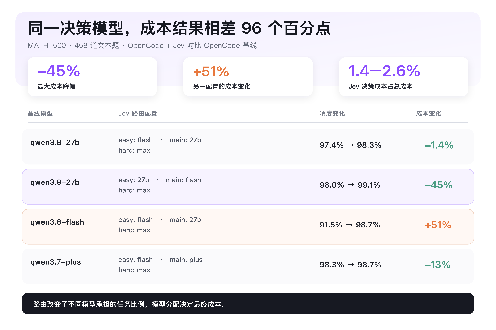
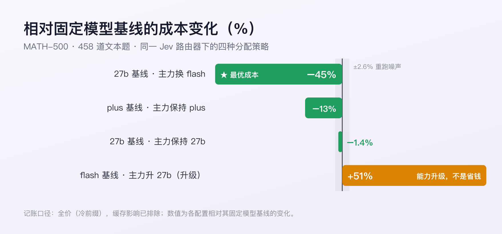
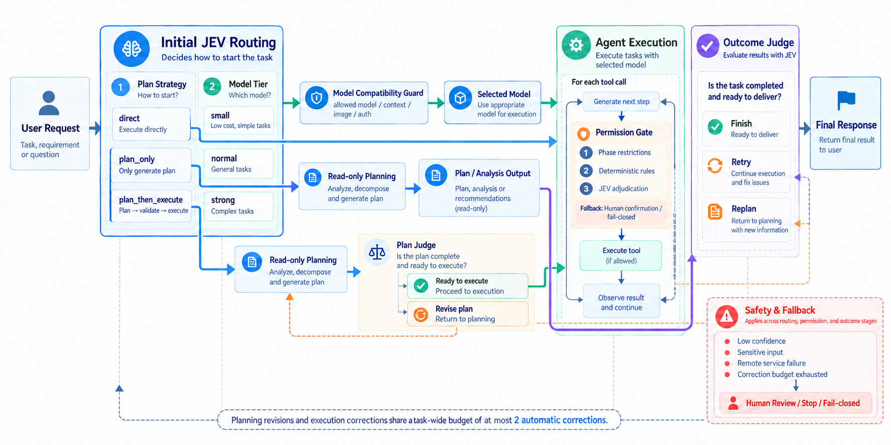

<div align="center">

# Pi JEV Governor

[pi](https://pi.dev) 编码代理的决策治理层，由 JEV 驱动。

**规划 · 模型路由 · 权限控制 · 结果校验**

Pi JEV Governor 把快速、类型化、带置信度的决策引入 pi 的 agent 生命周期——决定任务如何开始、交给哪个模型处理、工具操作是否放行、以及任务是否真的可以交付。

**MATH-500 上模型成本最多省 45%，精度不输。**<br>
Jev 决策开销 **1.4–2.6%** · 决策延迟 **P50 0.6–0.7 秒**

[](https://github.com/Pyromind-Dynamics/pi-jev-governor/actions/workflows/ci.yml)
[](LICENSE)


*确定性规则守硬边界。JEV 做有界决策。低置信与高风险交给人工。*

**[English](README.md)** | **简体中文**

</div>

<p align="center">
  
</p>

## 🚦 项目状态

- ✅ 规划策略路由：`direct` / `plan_only` / `plan_then_execute`
- ✅ 模型档位路由：`small` / `normal` / `strong`
- ✅ 模型兼容性守卫
- ✅ 分层权限治理
- ✅ 结果校验与自动纠正
- ✅ 结构化决策日志
- ✅ MATH-500 路由基准
- ✅ Pi 0.87.1 与 1.1.0 通过完整验收（各 54 项断言）
- 🚧 npm 发布
- 🚧 更广的编码类基准
- 🚧 更多路由策略

## 📊 基准结果（MATH-500）

我们在 HuggingFaceH4/MATH-500 的 458 道文本题（排除 42 道含图题）上评测了基于 JEV 的模型路由。基准在同一套 JEV Decisions API 与路由策略的 agent 集成上完成，覆盖 pi-jev 四个决策点中的三个（模型路由 / 权限 / 结果判定）；`plan_strategy` 为 pi-jev 独有，未在基准范围内。

每组配置都是「固定模型基线」与「JEV 路由」的对比：JEV 把每道题分配到 `easy` / `main` / `hard` 三档。四组配置中，精度全部持平或更高，成本随执行模型与档位的对应方式在 **−45% 到 +51%** 之间变化——路由器本身很便宜，决定成本的是它把活派给了谁。

<p align="center">
  
</p>

| 基线配置 | Jev 路由配置 | 精度变化 | 成本变化 |
|---|---|---|---|
| qwen3.8-27b | 简单题 flash / 主力 27b / 难题 max | 97.4% → 98.3% | −1.4% |
| qwen3.8-27b | 简单题 27b / 主力 flash / 难题 max | 98.0% → 99.1% | **−45%** |
| qwen3.8-flash | 简单题 flash / 主力 27b / 难题 max | 91.5% → 98.7% | +51% |
| qwen3.7-plus | 简单题 flash / 主力 plus / 难题 max | 98.3% → 98.7% | −13% |

**关键发现**

- 成本最多降 45%，精度不输。
- 路由策略决定成本：把便宜模型放进承担主要工作量的 main 档，比只用在 easy 档省得多。
- 价差决定空间：档位间模型价差越大，潜在节省越大。
- +51% 的配置是有意为之：把 main 档升级为更强的模型，用预算换能力。
- JEV 开销很小：占总成本 1.4–2.6%，决策延迟 P50 0.6–0.7 秒。

> 第三组较大的精度提升（+7.2pp）主要来自其弱得多的起点基线。
>
> 记账口径为全价（冷前缀）：实验使用动态前缀，缓存被排除在外。
>
> 📊 完整报告与方法论见 [docs/math500-final-report-20261003.md](docs/math500-final-report-20261003.md)

## 🧠 工作原理

Pi JEV Governor 把 JEV 放在 agent 生命周期中四个有界的决策点上，硬安全边界仍由确定性规则与人工兜底负责。

<p align="center">
  
</p>

### 四个决策点

| 决策 | 时机 | 输出 |
|---|---|---|
| 规划 | 任务开始 | `direct` / `plan_only` / `plan_then_execute` |
| 模型档位 | 任务开始 | `small` / `normal` / `strong` |
| 权限 | 每次工具调用 | 规则 → JEV → 人工 / fail-closed |
| 结果 | 交付前 | `finish` / `retry` / `replan` |

- `plan_strategy` 和 `tier` 合并在一次请求中。`plan_then_execute` 任务在执行前会额外发起一次 Outcome 请求校验计划。
- 规划修订与执行纠正共享最多 **2 次**的硬上限修正预算。
- 由 pi 直接加载，**无捆绑运行时依赖，不修改 pi 本身**。

<details>
<summary><strong>生命周期语义与状态细节</strong></summary>

```text
用户 prompt
   │
   ▼
路由：plan_strategy + tier
   ├─ direct ────────────────────────────────┐
   ├─ plan_only（只读）──────────────────────┤
   └─ planning（只读）                        │
        │ Outcome 校验计划                    │
        ├─ retry/replan → 修订规划            │
        ├─ finish → 恢复工具，开始执行         │
        └─ 不可用/低置信 → 停止                │
                                              ▼
                                     Outcome 校验交付物
                                        ├─ finish → 结束
                                        └─ retry/replan → 纠正并续跑
```

- 每次新的 `before_agent_start` 开启一个任务并清空其批准缓存。续跑、steering 和追问继承活动路由，不会重新路由。
- 状态以 `jev-state` 会话条目存储。会话恢复与分支导航通过 `getBranch()` 从活动分支还原，包括只读工具快照、修正预算和模型路由状态。
- 续跑在 settle 边界原子提交：状态条目与 `custom_message` 以 `continue: true` 一起返回，随后由 pi 重算最终上下文能否续跑。

</details>

## 🎬 在 Pi 中运行

在 pi TUI 中录制的四个任务——不是幻灯片：每条 prompt 提交后，底部状态栏（`jev:<phase>/<tier>`）与右下角模型指示器实时变化。

<table>
<tr>
<td align="center" width="50%"><br><b>一句话知识问答 → <code>direct/small</code></b><br><i>模型从 qwen3.7-plus 降到 qwen3.7-flash</i></td>
<td align="center" width="50%"><br><b>常规三步实现任务 → <code>direct/normal</code></b><br><i>从 qwen3.7-flash 回升到 qwen3.7-plus</i></td>
</tr>
<tr>
<td align="center" width="50%"><br><b>多方共享模块的高风险重构 → <code>plan_then_execute/strong</code></b><br><i>先在 qwen3.7-max 上做只读规划，规划期间仅允许只读命令</i></td>
<td align="center" width="50%"><br><b>架构设计题 → <code>plan_only/strong</code></b><br><i>交付物是分析报告，不做任何实现</i></td>
</tr>
</table>

使用 `scripts/run.sh --models qwen/qwen3.7-plus,qwen/qwen3.7-flash,qwen/qwen3.7-max` 录制。

## 🚀 快速开始

**1. 安装**（需要 pi 0.87.1+）：

```bash
pi install git:github.com/Pyromind-Dynamics/pi-jev-governor
```

**2. 配置** —— JEV 凭据和每档一个模型：

```bash
export PI_JEV_API_KEY="$OPENROUTER_API_KEY"
export PI_JEV_MODEL_SMALL="openrouter:qwen/qwen3.7-flash"
export PI_JEV_MODEL_NORMAL="openrouter:qwen/qwen3.7-plus"
export PI_JEV_MODEL_STRONG="openrouter:qwen/qwen3.7-max"
```

**3. 运行 `pi`**，提交任务，观察状态栏中的 `jev:<phase>/<tier>`。

不安装、直接试用：`pi -e ./pi-jev-governor`。仓库还提供 `.env.local` 模板与启动脚本（`./scripts/run.sh`）——见下文「配置」一节。

> 0.87.1 与 1.1.0 均通过完整验收（各 54 项断言；证据分别在 [`evidence/acceptance-20261008-163809`](evidence/acceptance-20261008-163809) 与 [`evidence/acceptance-20261008-180941`](evidence/acceptance-20261008-180941)）。`@earendil-works/pi-ai` 与 `@earendil-works/pi-coding-agent` 是 peer 依赖，由 pi 提供。锁定安装（`@<tag>`）与 npm 发布随首个 Release 提供。

## ⚙️ 配置

```bash
cp .env.local.example .env.local   # 填入 key 和模型
./scripts/run.sh                   # 在任意草稿项目目录下执行
```

最常用的变量：

| 环境变量 | 默认值 | 说明 |
|---|---|---|
| `PI_JEV_API_KEY` | *必填* | API 凭据 |
| `PI_JEV_MODEL_SMALL` / `_NORMAL` / `_STRONG` | *必填* | 每档一个 `provider:modelId` |
| `PI_JEV_ROUTE_CONFIDENCE` | `0.8` | 低于该置信度回退 direct/当前模型 |
| `PI_JEV_PERMISSION_CONFIDENCE` | `0.9` | 低于该置信度转人工确认；无 UI 则阻断 |
| `PI_JEV_OUTCOME_CONFIDENCE` | `0.8` | 计划只有在明确且高置信的 finish 下才进入执行 |
| `PI_JEV_MAX_CORRECTIONS` | `2` | 任务级预算，硬上限 2 |

<details>
<summary><strong>完整配置参考</strong></summary>

| 环境变量 | 默认值 | 说明 |
|---|---|---|
| `PI_JEV_ENABLED` | `true` | 设为 `false` 关闭全部四个决策 |
| `PI_JEV_URL` | `https://openrouter.ai/api/alpha/decisions` | JEV 端点 |
| `PI_JEV_API_KEY` | *必填* | API 凭据 |
| `PI_JEV_MODEL` | `typesafe/jev-1.13` | 决策模型 |
| `PI_JEV_TIMEOUT_MS` | `3000` | 整次请求总超时（1–60000 ms）。OpenRouter 实测常见 2–4 s，建议设 `10000` |
| `PI_JEV_MODEL_SMALL` | *必填* | `provider:modelId` |
| `PI_JEV_MODEL_NORMAL` | *必填* | `provider:modelId` |
| `PI_JEV_MODEL_STRONG` | *必填* | `provider:modelId` |
| `PI_JEV_ROUTE_CONFIDENCE` | `0.8` | 低于该置信度回退 direct/当前模型 |
| `PI_JEV_PERMISSION_CONFIDENCE` | `0.9` | 低于该置信度转人工确认；无 UI 则阻断 |
| `PI_JEV_OUTCOME_CONFIDENCE` | `0.8` | 计划只有在明确且高置信的 finish 下才进入执行 |
| `PI_JEV_MAX_CORRECTIONS` | `2` | 任务级预算，硬上限 2 |
| `PI_JEV_OUTCOME_GIT_DIFF` | `false` | 显式开启才发送 `git diff --stat`；从不发送 diff 正文 |
| `PI_JEV_PLAN_AUTO_EXECUTE` | `true` | 设为 `false` 时，计划通过后需 UI 确认才执行 |
| `PI_JEV_LOG_DIR` | 平台状态目录 | 显式指定日志目录 |

</details>

模型引用格式为 `provider:modelId`，按第一个冒号切分。

> **提示：** tier 切换只在路由目标模型的作用域内发生。
>
> - 作用域由 `--models`（复数）或 pi settings 的 enabledModels 定义，三档全列即可自由切换。
> - 只列部分档位时，超出作用域的切换会被 `scopedModels` 守卫跳过：TUI 弹一次性警告，状态栏仍显示路由档位，右下角模型指示器不变。
> - 想锁定单模型，把它作为 `--models` 的唯一条目。
> - `--model`（单数）只设定初始模型，不构成作用域，也不会阻止切换。

**tier 切换**在以下情况保留当前模型：目标模型无法解析、不在 `--models` 作用域内、上下文窗口不足、无法接受分支中已有的图片、provider 未配置鉴权，或用户手动切换过模型。

### 开关与状态

- `pi --no-jev` — 对本次调用禁用插件
- `/jev` — 显示当前阶段、tier、修正预算、决策计数和日志文件
- `/jev off` / `/jev on` — 会话级切换（`on` 不能覆盖 `--no-jev` 或 `PI_JEV_ENABLED=false`）

## 🛡 安全与隐私

### 权限门

四层权限管线：

1. **阶段门** — 规划阶段仅允许内置读工具和白名单内的只读 shell 命令
2. **确定性规则** — 拦截高危 shell 模式、放行内置读工具、遵循任务级批准
3. **JEV 裁决** — 干净且已脱敏的工具输入才发送给 JEV
4. **人工 / fail-closed** — `ask`、低置信、敏感输入或远端错误 → 转给用户；无 UI 则阻断

人工选择是任务级的：仅允许一次 · 允许本任务此调用 · 允许本任务此工具 · 阻止。缓存在下一个任务和会话树导航时清空。

### 隐私

插件为每个决策发送**最少量的证据**：

| 数据 | 远端行为 |
|---|---|
| 任务 prompt | 截断并擦除 secret 字面量 |
| 普通工具输入 | 敏感键脱敏，长度受限 |
| 干净 shell 命令 | 脱敏后发送 |
| 含凭据的命令 | **从不发送** — 本地确认或 fail-closed |
| 敏感文件证据 | 替换为省略标记 |
| 工具结果尾部 | ≤ 10 条，截断并脱敏 |
| `git diff --stat` | 仅显式开启时发送；从不发送 diff 正文 |

凭据检测刻意保持窄范围（Authorization/Bearer 头、`KEY=value` 凭据上下文、私钥头、配置 secret 字面量）。不使用广义高熵匹配——哈希常量和 git SHA 在合法命令中很常见。

<details>
<summary><strong>决策日志</strong></summary>

每个会话独立文件 `decisions-<session-id>.jsonl`。日志目录优先级：

1. `PI_JEV_LOG_DIR`
2. `$XDG_STATE_HOME/pi-jev`
3. macOS：`~/Library/Application Support/pi-jev`
4. Windows：`%LOCALAPPDATA%/pi-jev`
5. 兜底：`~/.local/state/pi-jev`

目录权限 `0700`，文件权限 `0600`。日志包含结构化答案、置信度、耗时、用量、实际生效动作和脱敏错误原因——不包含原始 prompt、工具参数、provider 响应体或密钥。

</details>

### 失败行为

远端配置缺失或无效时进入 `degraded` 模式（非完全旁路）：路由使用 direct/当前模型兜底，Outcome 自动化停止，但本地权限门保持生效。需要远端裁决的调用在有 UI 时询问用户，无 UI 时 fail-closed 阻断。

### 安全边界

本包是**工作流控制，不是操作系统级沙箱**。它与 pi 运行在同一进程、拥有相同权限。不可信或无人值守的执行请使用容器化或其他系统安全边界。

## 🧪 开发与测试

```bash
npm install
npm run typecheck
npm test
```

测试覆盖纯决策逻辑、扩展接线、并发权限确认、分支恢复、日志权限，以及基于 pi 公开 API 和 faux provider 的真实 agent 生命周期测试。

### 验收测试

自动化验收 harness 做端到端验证：真实的 pi、真实的 agent 模型，JEV 决策指向本地确定性 mock。每个用例留档四份证据并生成 `RESULTS.md` 汇总：

```bash
./scripts/run-acceptance.sh    # 23 个用例（H01–H22 及 H20b 变体）；需要 .env.local 与 PATH 中的 pi
```

交互 TUI 行为由 [docs/acceptance-tests.md](docs/acceptance-tests.md) 中的人工截图协议覆盖。

## 📚 文档

- [docs/design.md](docs/design.md) — v3 设计规范
- [docs/acceptance-tests.md](docs/acceptance-tests.md) — 验收测试协议
- [scripts/smoke.md](scripts/smoke.md) — 人工冒烟清单

## 许可证

MIT
